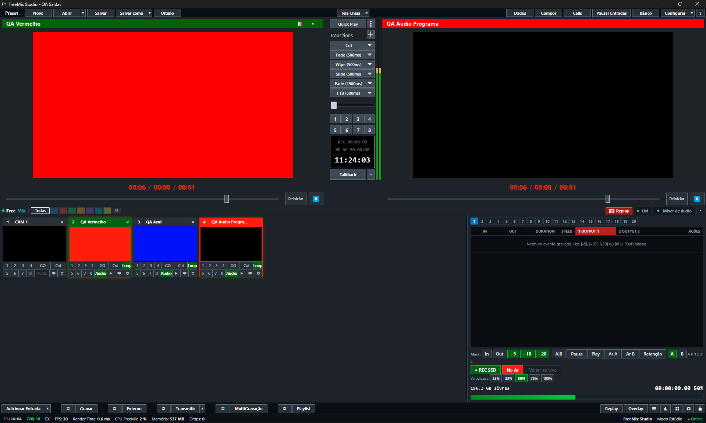

# FreeMix

**Open-source live video production & switcher suite** — mesa de corte broadcast com motor OBS (libobs/FFmpeg), lógica operacional própria, não clone do OBS nem skin do vMix.

---



---

## O que é

FreeMix une em uma única interface: **Preview • Program • T-Bar • Bandeja de Inputs • Mixer de Áudio • Overlays/DSK • Replay A/B • Playlist • Calls N-1 • DataSources • Multistream/SRT/NDI/SDI**.

A unidade principal é o **INPUT** (câmera, VT, GC, Call, Replay, Composição), não Scene/Source. O operador pensa em produção, não em configuração de engine.

---

## Telas-chave

### Calls N-1 — FreeMix Call Sala
Retorno automático N-1, publisher e sala de chamada integrados.


### Replay Multicam
Replay A/B multicâmera com marcação de pontos, câmera lenta, export.


### Overlays / DSK
Downstream keyers, templates GT,Lower Thirds, bugs, countdowns, scoreboards.


### Playout Engine & Monitor
Engine de playout com playlist, monitor de saída, cue/pre-roll, transições.
| Playout Engine | Playout Monitor |
|---|---|
|  |  |

---

## Início Rápido

```cmd
# Abrir a mesa (prepara motor + API + janelas extras)
ABRIR-FREEMIX.cmd

# Instalar em outra máquina/pasta
INSTALAR-FREEMIX.cmd
```

> **Não execute** `obs-vmix/bin/64bit/FreeMix.exe` direto — use o inicializador para subir os serviços das janelas extras.

---

## Estrutura do Repositório

| Pasta | Função |
|---|---|
| `FreeMix/` | Repositório privado: painel, ferramentas, patches (não usar como instalação) |
| `obs-vmix/` | Instalação do operador (atualização nativa exige fechar a mesa) |
| `freemix-app/` | Código-fonte nativo e build do fork |
| `entregas/` | Instalador e pacotes assinados da versão atual |
| `docs/`, `scripts/` | Guias e scripts organizados por função |
| `qa-*/` | Testes isolados e evidências |
| `downloads/` | Dependências verificadas |
| `archived/` | Documentos/scripts antigos com recibos |
| `screenshots/` | Telas do sistema (este README) |
| `release-keys/` | Chaves privadas de assinatura (local only) |

---

## Documentação

- [Documentação completa](docs/README.md)
- [Organização de pastas](docs/ORGANIZACAO.md)
- [Entrega atual](docs/ENTREGA-ATUAL.md)
- [Pendências reais](docs/PENDENCIAS-REAIS.md)
- [Preparar servidor/VPS](scripts/manutencao/PREPARAR-SERVIDOR.cmd)
- [Coletar logs (ZIP diagnóstico)](COLETAR-LOGS.cmd)

---

## Princípios de Produto

- **Não é clone do OBS** — usa libobs/FFmpeg como base, mas a lógica é de mesa broadcast
- **INPUT-first** — câmera, VT, GC, Call, Replay, Composição em um card integrado
- **Reduzir passos** — Call N-1 automático, Replay A/B, DataSources, multisserviços integrados
- **Resolver defeitos históricos do vMix** — não apenas imitá-lo
- **Zero interfaces originais** — tudo operado pela UI própria do FreeMix

> Ver visão completa em [`FreeMix/docs/PRODUCT-VISION.md`](FreeMix/docs/PRODUCT-VISION.md)

---

## Licença

Código-fonte: licença proprietária / source-available. Binários em `entregas/` assinados Ed25519 (sem Authenticode).