# FreeMix — README /060000

Estado vigente após aceite Root: **0.1.0-local.20261010060000, Native24/a047860**. Uma instalação própria, dois ciclos cooperativos counter0/crash0, Meter [0,0] preservados, diagnóstico instalado sanitizado e desinstalação conservadora. Operador preservado, não ativado/substituído.

Git do payload selado: **6adcd19315c01a4f01baaab2fd5d9e560872619b**. O commit posterior de provas/documentação não recompõe o payload. Manifesto 7107aa50b55dd2584be4fc30760af6ef1c85855c6995cd10758e65decc0a93b4; Setup 3a53cc01ea2998d785e4914c219084e6868ad4bf7b33fff31f074685878993bd; ZIP 82769392912badfb5a4f03a717181e915b404d8418fe7e2376f2702dddbfe821. Todos9582 arquivos assinados e2085pinsNative foram conferidos.

Menus/NAV/Replay Settings/Calls/Externo e as correções Calls/HDR desta fonte fazem parte do candidato600. O QA instalado usa HDR GET sem transmissão; mídia HDR local anterior continua uma prova separada.050500 foi candidato não selecionado: FAIL de observação API preservado, seguido de diagnóstico/uninstall em continuação separada; não virou PASS.035000 permanece como seleção anterior preservada.

Instale em destino novo/vazio. Estado e critérios em docs/CONTINUAR.md, docs/ENTREGA-ATUAL.md e docs/PENDENCIAS-REAIS.md.

Baseline aprovada somente no escopo dos recibos, sem promessa100%. A auditoria posterior identificou recuperação incompleta de operações incertas e um atalho FTB sem contrato público confirmável; ambos continuam em correção posterior, junto do retorno contínuo das Calls. IAB com backend Native real não prova CEF desktop, editores visíveis/foco/z-order, GPU/PCM, endurance ou todos encoders. Retorno custom Calls usa JPEG640×360 até5fps; vídeo contínuo25/30fps por fonte ainda requer pipeline próprio com PTS/backpressure/sincronismo, não só timer/hardware. Programa usa câmera virtual com taxa ideal solicitada, sem taxa efetiva homologada aqui. ASIO/SDI/PTZ/controladores físicos, WAN/TURN/bonding, Windows limpo, receptor/monitor HDR e NDI HDR Advanced SDK/licença/implementação continuam gates separados. GTZIP finito não implica compatibilidade universal/3D/frames ausentes. Alpha web abortado; ponte alpha nativa beta separada. Assinatura interna Ed25519; sem Authenticode.

Provas instaladas: qa-finalizacao/setup-060000-qa/report.json SHA 77d835df3da98d84c5e4458450cbbd0ecc2917e767dc43061d9551d7e53ded0c; allowlist SHA 703df68812198b839e1a697f8303805d0f4b9fc2c012108db3646398f998d25a; Root IAB files5 SHA 7c5b0acb987cd81f4a8179bc84a5592efffc91dfc089a9a5fee96f67306253d3.

---

## Histórico preservado — estado anterior à seleção060000

Referências a atual/pendente/próximo abaixo pertencem ao registro original; artefatos selados/recibos não foram reescritos.

# FreeMix

**Abrir sua mesa:** [ABRIR-FREEMIX.cmd](ABRIR-FREEMIX.cmd). O atalho `FreeMix Studio.lnk` faz a mesma coisa. O inicializador prepara motor + API e preserva a mesa já aberta.

**Instalar em outra pasta ou computador:** [INSTALAR-FREEMIX.cmd](INSTALAR-FREEMIX.cmd). Abre o instalador completo em `entregas`, independente deste projeto após a instalação. A instalação nova começa com uma mesa inicial; não importa automaticamente suas câmeras/projeto.

- [Documentação](docs/README.md): guias, entrega e pendências reais.
- [Organização](docs/ORGANIZACAO.md): função de cada pasta e histórico movido.
- [PREPARAR-SERVIDOR.cmd](scripts/manutencao/PREPARAR-SERVIDOR.cmd): prepara o kit para VPS; instruções em [Servidor](servidor/LEIA-ME.md).
- [COLETAR-LOGS.cmd](COLETAR-LOGS.cmd): gera ZIP local de diagnóstico, mesmo após crash, para enviar por e-mail ou WhatsApp. Não precisa de servidor e não abre o motor. Instruções em [Logs do beta](obs-vmix/docs/LOGS-BETA.md).

| Pasta | Uso |
|---|---|
| FreeMix/ | Repositório privado com painel, ferramentas e patches; não usar como instalação |
| obs-vmix/ | Instalação do operador; atualização nativa exige fechar a mesa normalmente |
| freemix-app/ | Código-fonte nativo e build do fork |
| entregas/ | Instalador e pacotes assinados da versão atual |
| docs/, scripts/ | Guias atuais e scripts auxiliares organizados por função |
| qa-portatil/, qa-finalizacao/, qa-replay/ | Testes isolados e evidências |
| downloads/ | Dependências verificadas e material de integração |
| archived/ | Documentos, scripts e referências antigas |
| node24/, rea/ | Ferramentas preservadas |
| release-keys/ | Chaves privadas locais de assinatura |

A organização moveu itens antigos para archived/, com recibos de origem/destino. Não abra diretamente `obs-vmix/bin/64bit/FreeMix.exe`: use o inicializador para preparar os serviços das janelas extras.

## Telas do Sistema (Screenshots)

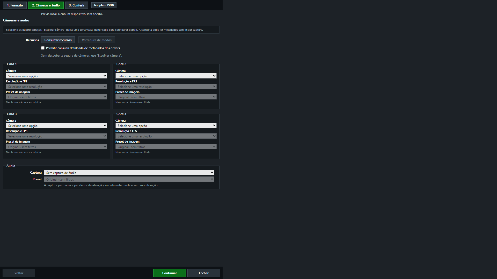

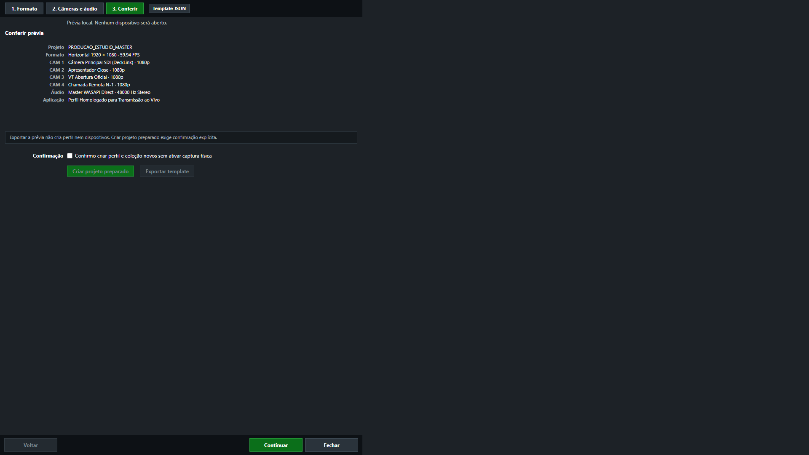

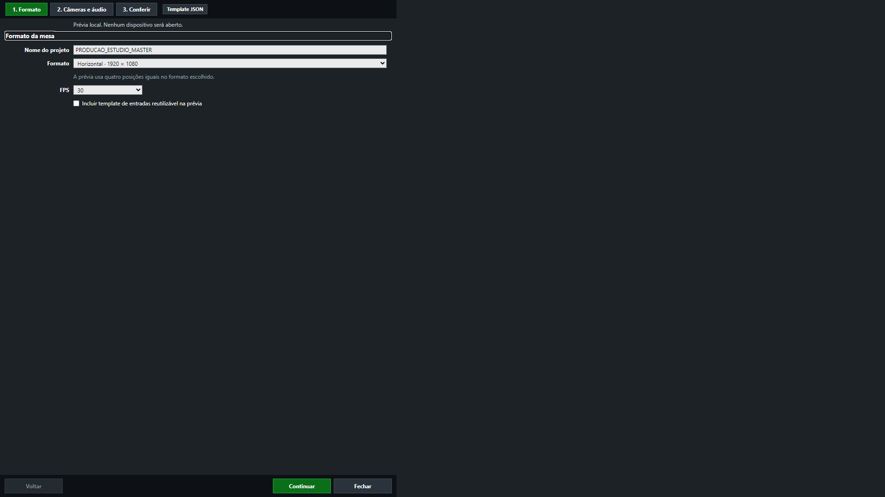

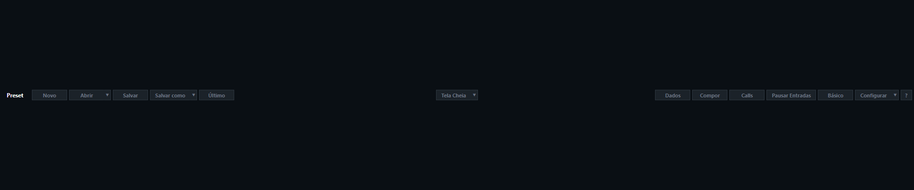

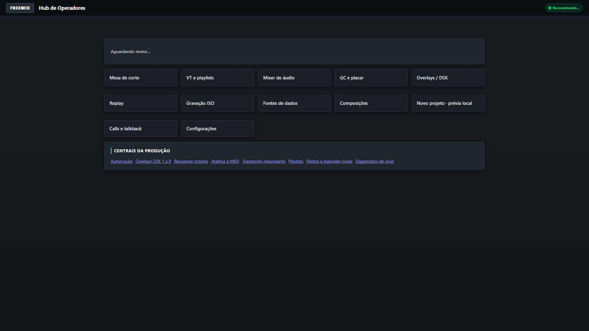

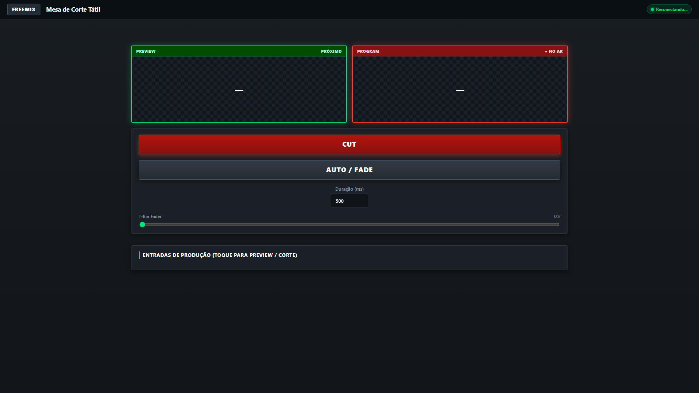

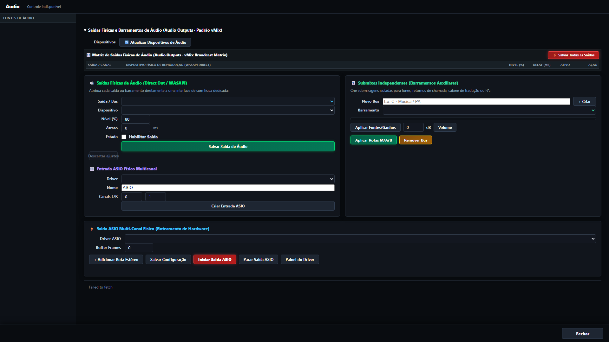

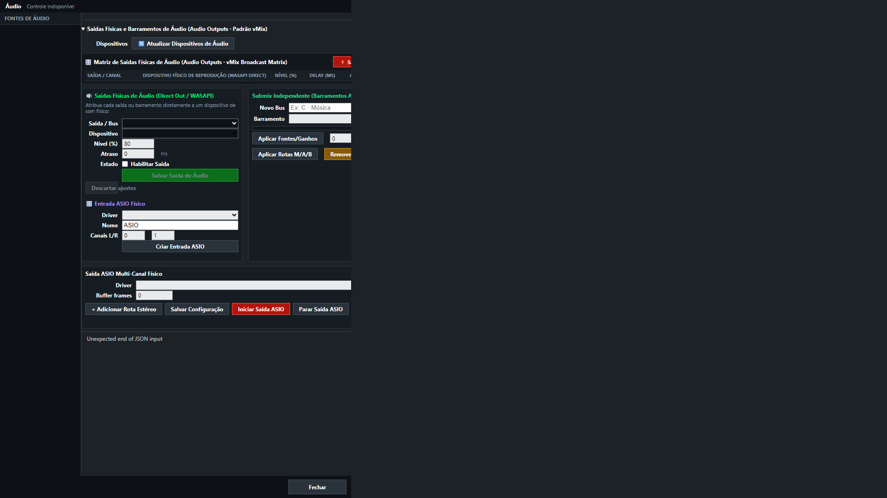

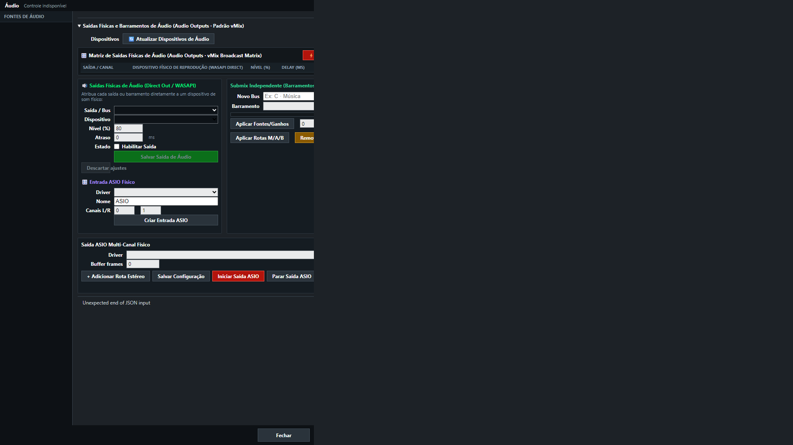

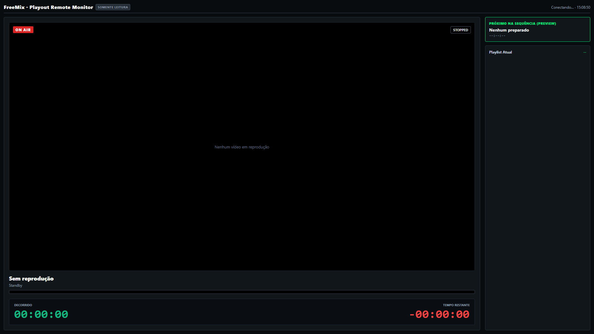

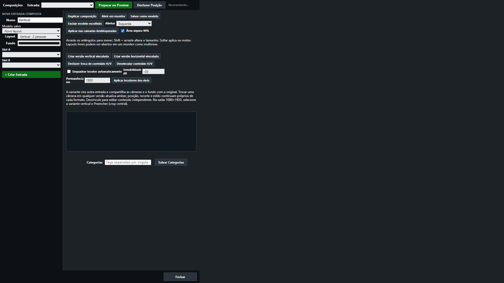

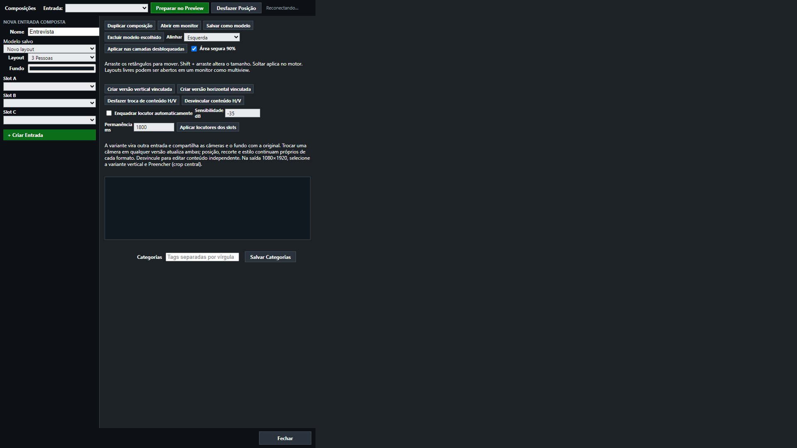

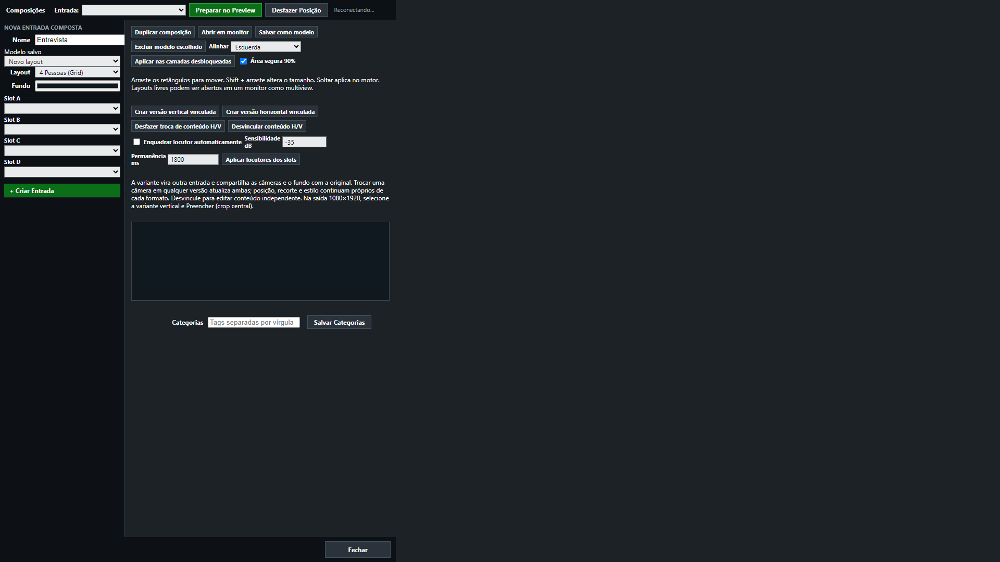

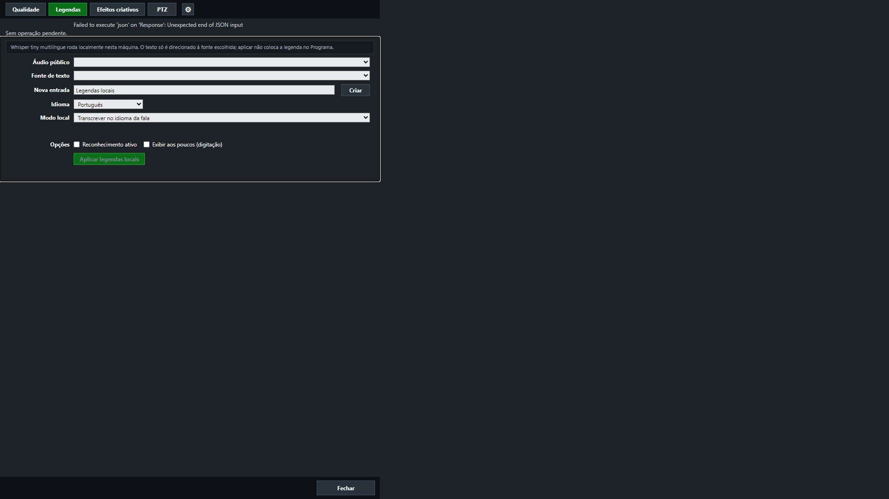

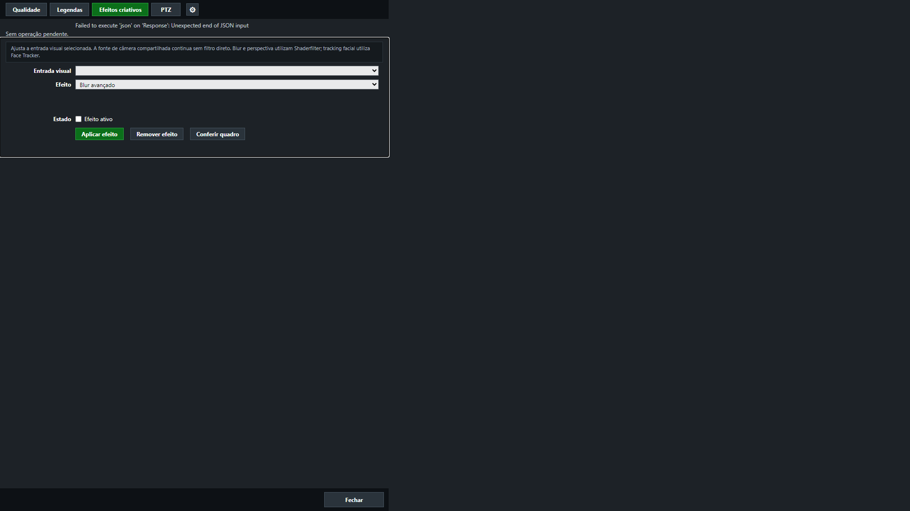

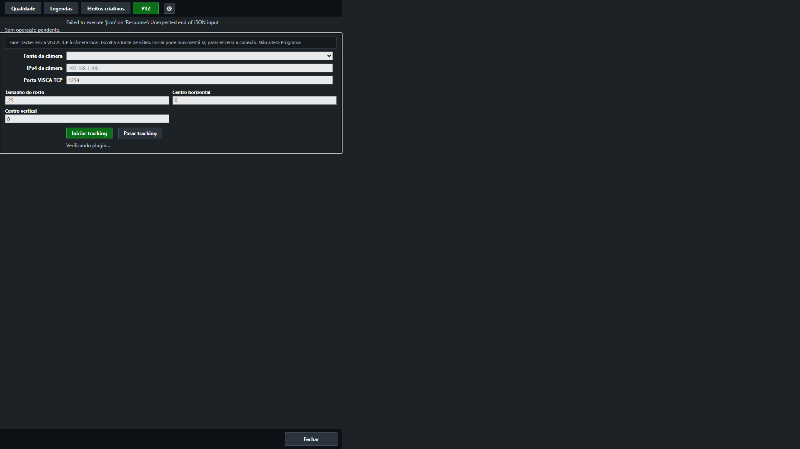

