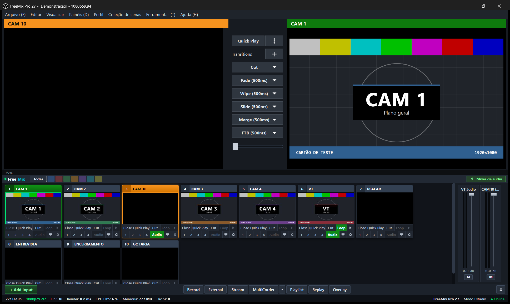
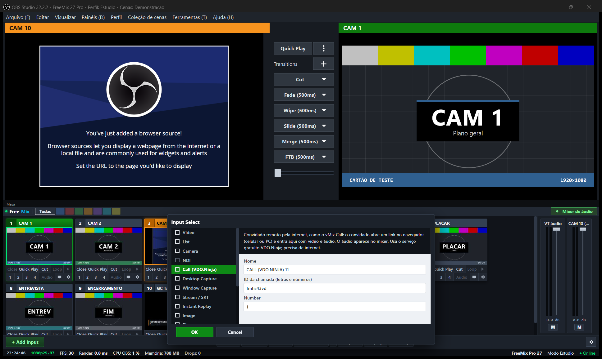

# 🎬 FreeMix

> **Open-Source Live Video Production & Switcher Suite**  
> *Transforme o motor do OBS Studio em uma mesa de corte broadcast profissional estilo vMix.*

---

---

## 🌟 O que é o FreeMix?

O **FreeMix** é uma suíte de produção e transmissão ao vivo de código aberto que une a estabilidade imbatível e os encoders de hardware do **OBS Studio** com a experiência operacional ágil e consolidada de mesas de corte broadcast (como vMix, TriCaster e switchers dedicados).

Diferente de forks engessados que quebram o código do OBS e ficam presos no passado, o FreeMix adota uma **arquitetura moderna e desacoplada**: a interface do operador e o motor de vídeo comunicam-se de forma assíncrona, garantindo que o pipeline de vídeo, gravação e transmissão continue a 60 fps estáveis com **zero quedas de quadros**.

---

## ✨ Recursos Principais

### 🎛️ Mesa de Corte Estilo Broadcast
* **Preview & Output Autênticos**: Identificação por cores padrão da indústria (Laranja para Preview, Verde para Output/Programa).
* **Tally Dinâmico**: Molduras luminosas e números destacados em tempo real nas entradas ativas.
* **Coluna de Transições Central**: Botões chanfrados de console (`Quick Play`, `Cut`, `Fade`, `Wipe`, `Slide`, `Merge`, `FTB`) e controle por **T-Bar metálico horizontal**.
* **Bandeja de Entradas com Abas de Categorias**: Organize suas câmeras, VTs, gráficos e chamadas por abas coloridas no topo.

### 📞 FreeMix Call (Convidados Remotos Integrados)
* **Zero Assinaturas**: Conexão ponto a ponto (P2P via WebRTC) criptografada e ultra-rápida.
* **Link com 1 Clique**: Ao adicionar uma entrada *FreeMix Call*, um link de convite é gerado automaticamente para o convidado abrir no celular ou computador.
* **Roteamento de Áudio Dedicado**: A voz do convidado entra como uma régua independente no mixer, pronta para equalização e mix-minus.
* **Retorno de Programa (PGM)**: Suporte a retorno visual e sonoro para o convidado via Câmera Virtual.

### 🔴 Gravação ISO / MultiCorder
* Gravação isolada de cada entrada ou câmera selecionada em arquivo próprio (`iso/`), rodando em paralelo com a transmissão do programa.

### 🎧 Barramentos de Áudio & Mixer Estéreo
* Faders logarítmicos cúbicos com VU meters estéreo responsivos.
* Botões de barramento **`M`** (Master/Transmissão), **`A`** (Aux A / Retorno de Convidado) e **`B`** (Aux B / Fones do Operador) para mix-minus sem eco.

### ⏱️ Barra de Controle e Relógio Broadcast
* Barra inferior dividida por zonas funcionais: Entradas (`+ Add Input`), Saídas (`Record`, `External`, `Stream`) e Produção (`MultiCorder`, `PlayList`, `Replay`, `Overlay`).
* Barra de status inferior com **relógio em tempo real (`HH:MM:SS`)**, resolução, FPS real, tempo de renderização e monitor de CPU.

---

## 🚀 Como Usar (Dois Cliques)

1. Baixe o pacote portátil pronto na aba [Releases](https://github.com/eddysangalli/FreeMix/releases).
2. Extraia o arquivo `.zip` em qualquer pasta da sua máquina (não requer instalação).
3. Execute o atalho **`Iniciar FreeMix.cmd`**.
   - A tela de abertura (*splash screen*) inicia o motor de vídeo;
   - Os caminhos de gravação e WebSocket são configurados automaticamente;
   - A barra de título e o ícone do FreeMix são ativados dinamicamente.

---

## 🏗️ Arquitetura & Roadmap

O FreeMix está sendo desenvolvido em fases evolutivas para a comunidade:
* **Fase 1 (Atual)**: Extensão portátil integrada via Web Dock de alta velocidade + WebSocket + scripts Win32 nativos.
* **Fase 2 (Próximo Passo)**: Plugin nativo em C++/Qt (`obs-freemix`) para registrar menus superiores exclusivos (`Produção`, `Entradas`, `Áudio`, `Saídas`, `Layout`, `Ferramentas`) e modo Operar vs. Editar composição.
* **Fase 3**: Casca modular de interface mantendo a biblioteca `libobs` 100% atualizável com lançamentos oficiais.

Consulte a documentação técnica completa:
* 📖 [Arquitetura & Design Técnico](docs/ARCHITECTURE.md)
* 🗺️ [Roadmap de Desenvolvimento](docs/ROADMAP.md)

---

## 🤝 Como Contribuir

Contribuições de desenvolvedores C++/Qt, designers de interfaces broadcast e operadores de transmissão ao vivo são muito bem-vindas!

1. Faça um Fork do projeto.
2. Crie sua branch (`git checkout -b feature/minha-melhoria`).
3. Commit suas alterações (`git commit -m 'feat: adiciona controle de barramento X'`).
4. Abra um Pull Request.

---

## 📜 Licença & Conformidade

Este projeto é distribuído sob a licença **GNU General Public License v2.0 (GPL-2.0)**.  
O FreeMix utiliza o motor de vídeo e plugins de código aberto da comunidade OBS Studio em total conformidade com seus termos de licença originais.
