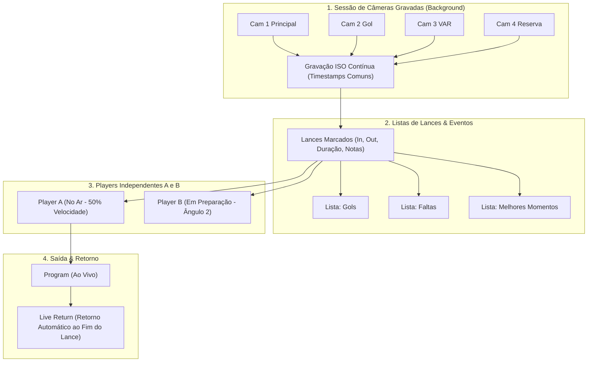

# FreeMix Studio — Especificação Operacional Completa da Interface e Serviços

Este documento estabelece a especificação funcional detalhada de cada controle, tela, menu e serviço do **FreeMix Studio**, tomando como referência a arquitetura operacional do **vMix 29** e consolidando o fluxo broadcast sobre a biblioteca `libobs`.

---

## 1. Barra Superior e Controles de Produção

| Controle | Ícone / Tipo | O que o botão faz | Opções oferecidas | Como altera a produção | O que é persistido / recuperado no Preset |
| :--- | :--- | :--- | :--- | :--- | :--- |
| **Novo** | `Plus` | Inicia uma produção limpa do zero. | Se houver alterações pendentes (`dirty state`), exibe alerta: *Salvar / Descartar / Cancelar*. | Limpa a lista de cenas, desliga overlays e zera matriz de áudio. | Define nome como `Nova_Producao.fmx` e zera histórico de alterações. |
| **Abrir Preset** | `FolderOpen` | Carrega um arquivo de produção salvo (`*.fmx`). | Seletor de arquivos do Windows; validação de integridade JSON schema v1.1.0. | Recria imediatamente todas as entradas, restaura posições, volumes, filtros e conexões de rede. | Recupera lista completa de entradas, 8 overlays, mapeamentos de dados e sessão de replay. |
| **Recentes** | `Clock` / Dropdown | Lista os últimos 5 presets utilizados. | Lista de arquivos com caminhos absolutos e datas de modificação. | Ao clicar em um item, executa a rotina de validação e carga. | Lista de recentes salva nas preferências globais do operador (`user.ini`). |
| **Salvar** | `Save` | Grava o documento de produção atual no disco. | Se for produção nova sem nome, redireciona para *Salvar Como*. | Não interrompe a transmissão ou gravação (escrita atômica em `.fmx.tmp` seguida de rename). | Atualiza timestamp `modified`, hash SHA-256 e desliga o indicador visual `*`. |
| **Salvar Como** | `SaveAs` | Salva uma cópia versionada da produção em outro local. | Campo para novo nome e seleção de diretório de destino. | Altera o ponteiro de arquivo ativo da produção em tempo real. | Atualiza metadados e adiciona nova entrada no histórico de recentes. |
| **Importar Preset** | `Import` | Incorpora entradas e gráficos de outro preset sem zerar o atual. | Seleção de entradas individuais a importar; resolução de conflitos de nome. | Acrescenta novas entradas na bandeja preservando as que já estão no ar. | Mescla os dados no preset atual gerando novos UUIDs únicos para evitar colisões. |
| **📺 Monitores** | `Display` (Toggle) | Alterna exibição da seção superior de Preview e Program. | Estados: `ON` (exibe os dois monitores com T-Bar) / `OFF` (modo compacto de mesa de corte). | Redimensiona a área central da interface sem afetar a saída física/HDMI. | Preferência de visualização mantida na sessão do operador. |
| **⚙ Configurações** | `Gear` | Abre a central modal de configurações com 8 abas. | Geral, Transmissão, Gravação, Áudio, Vídeo, Overlays, Replay, Updates. | Altera parâmetros globais do motor e do estúdio ao clicar em *Aplicar/Salvar*. | Opções globais salvas no sistema; opções de produção salvas no `.fmx`. |
| **⚡ Atalhos / MIDI** | `Bolt` | Abre o gerenciador de atalhos e mapeamento de controladores. | Tabela de comandos, captura de teclas, detector de faders/pads (*MIDI Learn*). | Vincula eventos de hardware à execução direta de comandos. | Atalhos da produção salvos no `.fmx`; atalhos globais em `config/shortcuts.ini`. |
| **📊 DataSources** | `Table` | Abre o gerenciador de tabelas de dados vinculadas aos GCs. | Fontes CSV, XLSX, JSON local/HTTP; editor de vínculos coluna -> campo. | Altera textos e fotos dos geradores de caracteres em tempo real. | Fontes, caminhos e vínculos salvos integralmente no preset. |
| **🔲 Overlays (8)** | `Layers` | Abre a central de controle e configuração dos 8 canais DSK. | Canais 1 a 8; posição PiP, opacidade, transição (Cut/Fade/Slide), auto-off timer. | Liga/desliga camadas gráficas sobrepostas ao sinal de Program. | Estado de cada um dos 8 canais (associação, posição, DSK) salvo no preset. |
| **⏪ Replay Multi-Cam** | `Replay` | Abre a central de replay multi-câmera com Players A e B. | Câmeras ISO participantes, Players A e B, marcações In/Out e listas de lances. | Controla gravação em background e envio de câmera lenta ao PGM. | Sessão, câmeras e metadados dos lances salvos no preset. |

---

## 2. Monitores de Estúdio e Barra de Transições Central

* **Monitor de Preview (Prévia)**:
  * **O que faz**: Exibe a próxima entrada a ser comutada ou o ângulo preparado pelo operador.
  * **Opções**: Guias de Safe Area (80% para ação, 90% para títulos), resolução e botão *Quick Play* (reproduz mídia ao entrar em preview).
  * **Alteração na Produção**: Altera o barramento de Preview da `libobs` via requisição WebSocket `SetCurrentPreviewScene`.
* **Coluna Central de Transições**:
  * **CUT**: Corte seco imediato entre Preview e Program (0 ms).
  * **FADE**: Dissolvência cruzada suave com tempos predefinidos (250 ms, 500 ms, 1000 ms).
  * **ZOOM**: Transição com efeito de aproximação digital suave.
  * **WIPE**: Varredura lateral limpa.
  * **STINGER 1 a 4**: Vinheta animada com canal Alpha transparente e ponto de corte sincronizado (*Cut Point*).
  * **FTB (Fade to Black)**: Botão de segurança de emergência com LED piscante; escurece o Program progressivamente a preto sem perder o estado de comutação da mesa.
  * **Alavanca T-Bar Broadcast**: Slider vertical analógico que permite controle manual milimétrico da interpolação de corte (0% a 100%).
* **Monitor de Program (PGM / No Ar)**:
  * **O que faz**: Exibe exatamente o sinal transmitido e gravado, com tally vermelho `● ON AIR`.
  * **Opções**: Exibição de timecode da produção (`HH:MM:SS:FF`) e atalhos rápidos de Overlay.

---

## 3. Oito Canais de Overlays Independentes (1 a 8)

Conforme a documentação oficial do vMix 29, o FreeMix Studio implementa **oito canais de sobreposição simultâneos**, permitindo construir composições complexas sem colisão de camadas:

1. **Overlay 1 (Bug de Emissora / Marca)**: Canto superior direito, 100% de opacidade, transição Fade 300ms, permanente.
2. **Overlay 2 (Lower Third Principal)**: Tarja inferior com nome e cargo do entrevistado, transição Slide lateral, duração 400ms.
3. **Overlay 3 (Plantão Urgente / Tarja Dupla)**: Destaque de breaking news, transição Zoom, duração 350ms.
4. **Overlay 4 (Placar Esportivo & Cronômetro)**: Canto superior esquerdo, corte seco (Cut), atualização contínua de relógio.
5. **Overlay 5 (Picture-in-Picture / Convidado)**: Canto inferior direito (25% de escala) com borda decorativa, transição Fade.
6. **Overlay 6 (QR Code Pix / Interatividade)**: Canto inferior direito sobreposto, transição Fade suave, auto-off em 20 segundos.
7. **Overlay 7 (Libras / Tradução Acessível)**: Canto inferior direito ou esquerdo em janela dedicada de 18% de escala.
8. **Overlay 8 (Ticker de Notícias / Rodapé Rotativo)**: Faixa de rolagem contínua na borda inferior da tela (0 a 100% de largura).

### Regras Operacionais dos Overlays:
* **Independência Estrita**: Acionar ou retirar qualquer um dos 8 overlays preserva o estado dos outros 7 canais ativos.
* **Comutação de Cena no Program**: Alternar a câmera no ar (via Cut ou Fade) **não afeta** os overlays que estiverem no ar.
* **Retirar Todos os Overlays**: Comando de 1 clique que executa a transição de saída de todos os 8 canais sem alterar o sinal da câmera no Program.

---

## 4. Central de Replay com Múltiplas Câmeras, Players A e B e Listas

A arquitetura de Replay do FreeMix separa formalmente quatro componentes fundamentais:



1. **Câmeras Gravadas (Sessão Multi-Cam)**:
   * Suporte a 2 até 4 câmeras simultâneas em gravação contínua no buffer circular.
   * As câmeras são capturadas mesmo quando não estão nem em Preview nem em Program.
   * Sincronização garantida por timestamps comuns de quadro.
2. **Players Desacoplados A e B**:
   * O **Player A** pode estar em exibição no Program em 50% de velocidade enquanto o **Player B** busca o ângulo reverso ou marca o ponto de impacto em pausa.
   * Indicação explícita de qual player está ativo e qual está associado à saída.
3. **Listas de Lances**:
   * Criação rápida de lances pelos botões `[-5s]`, `[-10s]`, `[-20s]` ou marcação manual `[MARK IN]` e `[MARK OUT]`.
   * Organização por categorias: *Gols*, *Faltas*, *Revisão VAR*, *Melhores Momentos*.
4. **Transporte e Velocidades Suportadas**:
   * Reprodução em 10%, 25%, 33%, 50%, 75% e 100%.
   * Ao finalizar a reprodução do lance, a opção configurável de **Retorno ao Vivo** comuta automaticamente a mesa de volta para a câmera principal sem corte brusco.

---

## 5. Central de Fontes de Dados (DataSources) e Vínculos com GCs

* **Conectores Nativos**:
  * **Tabela Manual**: Planilha interna editável célula a célula na interface.
  * **CSV**: Arquivos `.csv` locais com delimitadores configuráveis (vírgula, ponto-e-vírgula).
  * **Google Sheets**: Sincronização via link público de exportação CSV com atualização periódica a cada N segundos.
  * **JSON**: Arquivos locais ou APIs REST (HTTP GET) com parsing automático de chaves.
  * **XLSX**: Planilhas Excel com seleção de aba.
* **Editor de Vínculos**:
  * Associa colunas da tabela aos seletores do template HTML/GC (ex: `Linha.Nome` -> `#txt_nome`, `Linha.Foto` -> `#img_foto`).
  * Controles de transporte: `[Anterior]`, `[Próximo]`, `[Linha N]`.
  * Publicação On-Air segura: alteração dos dados na tabela pode ser visualizada previamente em Preview antes de ser enviada ao Program.

---

## 6. O Preset como Documento Integral da Produção (`*.fmx`)

O arquivo `.fmx` (formato JSON v1.1.0) armazena a totalidade dos dados operacionais da produção:

```json
{
  "version": "1.1.0",
  "schema": "FreeMix.Production.Preset",
  "metadata": {
    "name": "Producao_Estudio_Master.fmx",
    "author": "Operador Broadcast",
    "created": "2026-10-07T02:00:00Z",
    "modified": "2026-10-07T02:15:30Z",
    "resolution": "1920x1080",
    "fps": 60
  },
  "inputs": [],
  "overlays": [],
  "datasources": [],
  "replaySession": {},
  "audioRouting": {},
  "outputs": []
}
```

* **Salvar Atômico**: Escrita em arquivo temporário `.fmx.tmp` com renomeação instantânea para prevenir perda de dados em quedas de energia.
* **Relocalização de Mídias Ausentes**: Ao abrir um preset, se um arquivo de vídeo ou imagem foi movido, o FreeMix exibe a janela de busca para apontar o novo local da pasta com remapeamento automático relativo.
